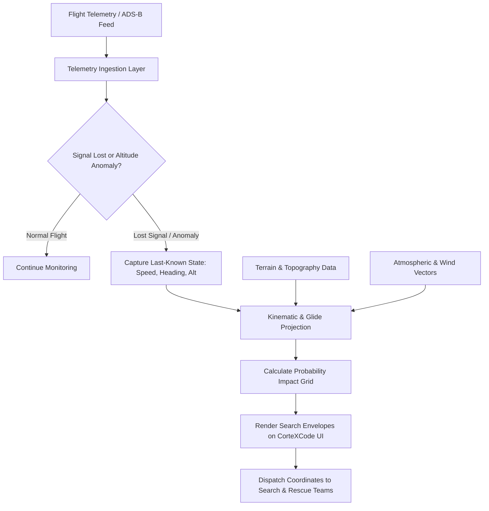

# CorteXCode

> An emergency flight trajectory tracker and downed-aircraft detection system engineered to estimate, localize, and predict crash coordinates for missing or disappeared aircraft.

[](https://CorteXCode.lovable.app)
[](https://lovable.dev)
[](https://www.typescriptlang.org/)
[](https://tanstack.com/start)

---

## 1. What We Built

**CorteXCode** is a specialized aviation search-and-rescue platform accessible at [CorteXCode.lovable.app](https://CorteXCode.lovable.app). The application processes historical radar streams, telemetry feeds (ADS-B), transponder loss events, and terrain elevation datasets to determine the most probable crash and impact locations of missing aircraft.

- **Geospatial & Vector Mapping Interface:** A reactive tracking dashboard built with React, TypeScript, and Tailwind CSS to plot flight paths and search radius envelopes.
- **High-Performance SSR & Server Functions:** Powered by TanStack Start to run trajectory projection algorithms and ingest real-time flight telemetry.
- **Impact Zone Prediction Engine:** Mathematical extrapolations of descent rates, glide ratios, and last-known radar coordinates to pinpoint search grids.
- **Continuous Deployment Pipeline:** Fully integrated with Lovable and GitHub for rapid updates and collaborative engineering[cite: 6].

---

## 2. Problem Statement Addressed

When an aircraft vanishes from radar or suffers an in-flight catastrophic failure, critical response time is lost due to several systemic challenges:

1. **Radar Blackouts & Transponder Disconnects:** Once an aircraft enters unmonitored airspace or loses power, standard civilian radar loses tracking data instantly.
2. **Massive Search Perimeters:** Without immediate kinematic extrapolation, search-and-rescue (SAR) teams are forced to comb through thousands of square nautical miles of open ocean or dense wilderness.
3. **Delayed Telemetry Correlation:** Ingesting last-ping GPS coordinates, wind vector shifts, and terrain topographical maps typically takes hours or days using disjointed tools.

### How CorteXCode Solves This

- **Last-Known Vector Extrapolation:** Automatically models fuel depletion, glide ratios, and wind vectors from the final ADS-B ping to project possible impact trajectories.
- **Dynamic Search Radius Generation:** Visualizes probability-weighted concentric search sectors directly on the map interface.
- **Rapid Web-Based Coordination:** Provides search teams with an accessible, real-time map interface without requiring heavy local software installation.

---

## 3. System Architecture & Detection Flow

### Flight Crash Detection & Localization Pipeline



### Full-Stack Architecture

```mermaid
graph TD
    User([Search & Rescue Operator])
    
    subgraph Client ["Client Browser (CorteXCode.lovable.app)"]
        UI[React + Tailwind UI Dashboard]
        Map[Interactive Map & Coordinate Overlays]
        Router[TanStack Router]
    end

    subgraph Server ["Full-Stack App Layer (TanStack Start)"]
        SSR[SSR & Hydration]
        API[Flight Trajectory & Ingestion APIs]
    end

    subgraph External ["Aviation Data & Processing"]
        ADSB[(ADS-B & Radar Telemetry Feeds)]
        GIS[(Terrain & Wind Vector Models)]
    end

    subgraph DevSync ["Development Engine"]
        Lovable[Lovable Prompt Engine]
        Repo[(GitHub Repository)]
    end

    User --> UI
    UI <--> Map
    UI <--> Router
    Router <--> SSR
    SSR <--> API
    API <--> ADSB
    API <--> GIS
    Lovable <-->|Bidirectional Sync| Repo
```4. How to Run It
Prerequisites
Node.js (v18.0.0 or higher)[cite: 6]

npm

[cite: 6]

Step 1: Clone the Repository
Bash
git clone <your-repository-url>
cd CorteX-Code
```[cite: 6]

### Step 2: Install Dependencies

```bash
npm install
```[cite: 6]

### Step 3: Environment Setup

Create an environment configuration file:

```bash
cp .env.example .env.local
Add any external aviation API credentials, map tiles tokens, or telemetry keys inside .env.local:

Code snippet
VITE_MAPBOX_TOKEN=your_mapbox_token_here
FLIGHT_DATA_API_KEY=your_telemetry_key_here
Step 4: Start the Local Development Server
Bash
npm run dev
```[cite: 6]

Visit [http://localhost:3000](http://localhost:3000) in your browser to interact with the tracking interface.

---

## 5. Available Scripts

| Command | Action |
| :--- | :--- |
| `npm run dev`[cite: 6] | Runs the development environment with hot module replacement |
| `npm run build` | Compiles and optimizes the application for production |
| `npm run preview` | Runs the production build locally for verification |
| `npm run lint` | Analyzes code for style, typing, and syntax errors |

---

## 6. Project Structure

```text
├── public/                 # Static assets, map markers, aircraft icons
├── src/
│   ├── components/         # Map view, search-radius plots, telemetry panels
│   ├── hooks/              # Coordinate tracking and flight state hooks
│   ├── routes/             # TanStack file-based routes and API handlers
│   ├── lib/                # Flight trajectory models, math helpers, GIS utilities
│   └── styles/             # Tailwind CSS stylesheets
├── package.json            # Application dependencies and scripts
├── tsconfig.json           # TypeScript configuration
└── tailwind.config.ts      # Tailwind design configuration
License
This project is licensed under the MIT License.
